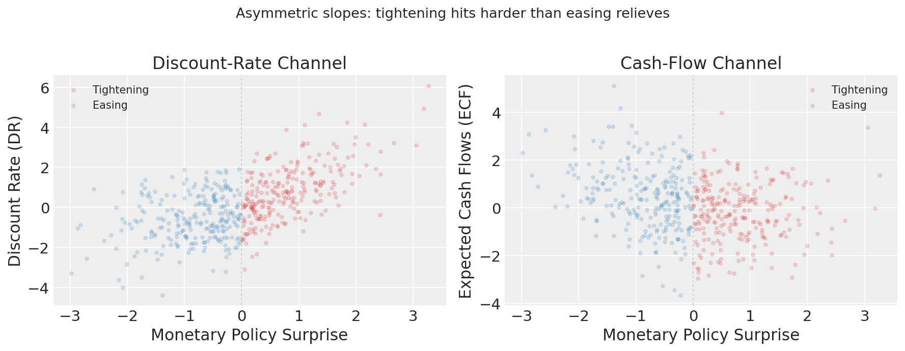
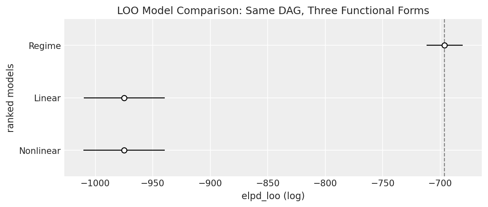
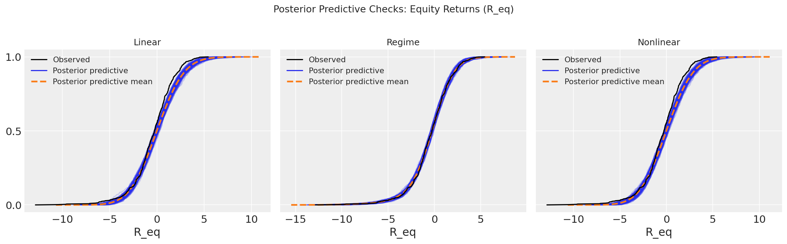
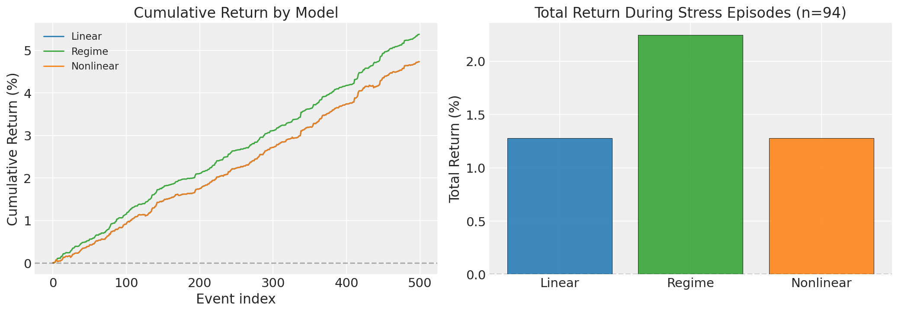
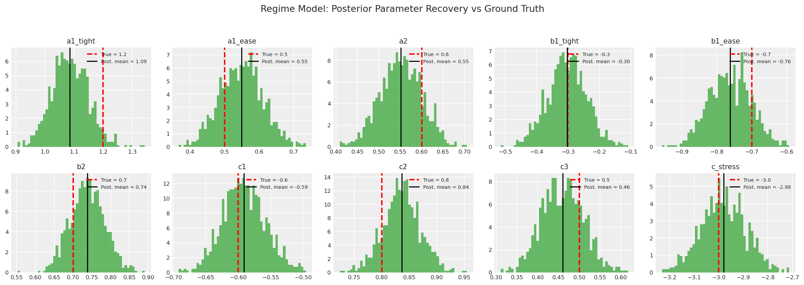

# Congratulations, You Have a DAG. Now What?

**Authored by**: PyMC Labs

---

The ADIA Lab Causal Discovery Challenge demonstrated that supervised ML can classify causal roles from observational data at ~77% balanced accuracy — nearly double the ~40% achieved by classical constraint-based methods (Olivetti et al., 2024). In consequence, institutions that can generate thousands of realistic labeled simulations now hold a structural advantage in causal discovery.

But recovering a DAG is only the first step. A DAG tells you *what* causes *what* — not *how*. 

**Congratulations, You Have a DAG. Now What?**

To exemplify that identifying a dag is just a first step that still leaves you far away from making money, we build a simple example in which a known dag can follow different functional forms. Each functional form generates different results, and choosing the right modeling techniqus may be the difference between making and loosing money. There is were PyMC can bridge the gap.

We use a well grounded casual example in the literature, by following the causal relation between policy surprises and equity returns s (Bernanke & Kuttner, 2005). The example shows that knowing the DAG  still leaves open the functional form of those relationships. Is the response linear? Does it switch regimes between tightening and easing cycles? Do effects saturate at extremes?

The answer matters enormously for anyone who wants to trade the insight. **The same causal structure combined with three different functional forms produces dramatically different P&L outcomes under stress — a 76% gap between the correct and wrong models during the most volatile episodes**. PyMC identifies the correct one.

---

## The Structure: Bernanke-Kuttner Channels

The canonical DAG from the monetary policy transmission literature decomposes equity return responses to policy surprises into two channels:

```
  Macro news (MN) ──────────────────────────┐
       │                                     │
       ▼                                     ▼
  MP_surprise ──► Discount rates (DR) ──► Equity return (R_eq)
       │                                     ▲
       └──────► Expected cash flows (ECF) ───┘
                                             ▲
  Risk sentiment (RS) ───────────────────────┘
```

The structural equations take the general form:

$$DR = f_1(\text{MP\_surp}, RS) + \varepsilon_1$$
$$ECF = f_2(\text{MP\_surp}, MN) + \varepsilon_2$$
$$R_{eq} = f_3(DR, ECF, RS) + \varepsilon_3$$

The causal graph is agreed upon — it follows directly from Bernanke & Kuttner (2005). What remains open is the shape of $f_1, f_2, f_3$.

---

## The Asymmetry Is Already Visible in the Data

Before fitting any model, a simple scatter plot reveals the core problem with the linear assumption.



**Left panel (Discount-Rate channel)**: Tightening surprises (red) drive up discount rates with a noticeably steeper slope than easing surprises (blue) bring them down. The cloud of red points climbs sharply; the blue cloud is flatter.

**Right panel (Cash-Flow channel)**: The asymmetry runs in the opposite direction. Easing surprises produce a steeper negative relationship with expected cash flows — the forward-looking growth stimulus effect — while tightening's contractionary signal is more muted.

A linear model forced to fit both regimes simultaneously will average across this asymmetry. It will systematically overestimate the discount-rate response during easing and underestimate it during tightening — exactly the observations where position sizing matters most.

---

## Same DAG, Three Stories

We generate synthetic data from a regime-switching data-generating process (the ground truth), then fit three competing PyMC models that all share the same DAG.

**The ground truth** (regime-switching DGP): tightening surprises hit discount rates 2.4× harder than easing surprises (`1.2 vs 0.5`). During stress episodes — triggered by an independent contagion shock uncorrelated with the main predictors — an amplification term suppresses equity returns sharply.

```python
def dgp_mp_regime(n=500, seed=42):
    tightening = MP_surp > 0
    DR = np.where(tightening, 1.2 * MP_surp, 0.5 * MP_surp) + 0.6 * RS + noise
    ECF = np.where(tightening, -0.3 * MP_surp, -0.7 * MP_surp) + 0.7 * MN + noise
    Z = rng.normal(0, 1, n)          # independent contagion shock (unobserved driver)
    stress = Z > 1.0                 # ~19% of events, uncorrelated with RS/MN/MP_surp
    R_eq = -0.6 * DR + 0.8 * ECF + 0.5 * RS + np.where(stress, -3.0 * |MP_surp|, 0) + noise
```

**Model A — Linear**: Symmetric, proportional effects. One slope for both tightening and easing. The textbook baseline.

**Model B — Regime-switching**: Separate slopes for tightening vs easing in both channels, plus a stress-period amplification term in equity returns. Encodes the empirical regularity.

**Model C — Nonlinear**: Smooth `tanh` saturation in both channels with an interaction term. Captures diminishing returns but treats the asymmetry as a smooth transition rather than a discrete switch.

The regime-switching PyMC model is:

```python
tight = (mp_vals > 0).astype(float)
stress = df["stress"].values          # independent contagion indicator from DGP

with pm.Model() as model_regime:
    # Discount-rate channel: separate slope per regime
    a1_t = pm.Normal("a1_tight", mu=0, sigma=2)
    a1_e = pm.Normal("a1_ease", mu=0, sigma=2)
    a2   = pm.Normal("a2", mu=0, sigma=2)
    dr_mu = (a1_t * tight + a1_e * (1 - tight)) * mp_vals + a2 * rs_vals
    pm.Normal("DR", mu=dr_mu, sigma=pm.HalfNormal("sigma_dr", 2), observed=dr_vals)

    # Cash-flow channel: regime-dependent slopes (analogous)
    # ...

    # Equity returns: plus stress-period amplification
    c_stress = pm.Normal("c_stress", mu=0, sigma=2)
    req_mu = c1*dr_vals + c2*ecf_vals + c3*rs_vals + c_stress * stress * np.abs(mp_vals)
    pm.Normal("R_eq", mu=req_mu, sigma=pm.HalfNormal("sigma_req", 2), observed=req_vals)
```

The regime indicators (`tight`, `stress`) are deterministic functions of observable data — no latent discrete variables, fully NUTS-compatible.

---

## Letting the Data Decide: LOO Model Comparison

We fit all three models (2 chains, 500 draws, target acceptance 0.95) and compare out-of-sample predictive performance via Leave-One-Out cross-validation:

```python
comparison = az.compare(traces, ic="loo", var_name="R_eq")
```



The result is unambiguous. The regime-switching model (ELPD = −696) is separated from both alternatives (ELPD ≈ −975) by **279 log-points — more than 7× the standard error of the difference**. This is not a marginal improvement; the data strongly prefer the model that respects the empirical asymmetry between tightening and easing.

Notably, the Nonlinear (`tanh`) model is essentially tied with the Linear model. Smooth saturation is not the right nonlinearity here. The discount-rate channel does not gradually curve — it switches. Approximating a step change with a sigmoid wastes flexibility and gains nothing.

| Model | ELPD (LOO) | SE | Δ ELPD vs best |
|---|---:|---:|---:|
| **Regime** | **−696** | **16** | **0** |
| Linear | −975 | 35 | −279 |
| Nonlinear | −975 | 35 | −279 |

---

## Posterior Predictive Checks: A Subtler Signal

LOO tells you which model predicts better. Posterior predictive checks tell you *where* models fail.



All three models reproduce the bulk of the equity return distribution. The cumulative density functions (blue = posterior predictive draws, black = observed) overlap tightly in the center. But the tails diverge.

The Regime model's x-axis extends to −10, while the Linear and Nonlinear panels barely reach −7. Only the regime-switching specification generates the left-tail mass consistent with the stress-amplified drawdowns in the data. The linear model's predictive distribution is systematically too narrow at the left extremes — precisely the events that drive risk and position-sizing decisions.

---

## Wrong Form, Right DAG, Bad P&L

The LOO score is a statistical number. The return is the economic consequence.

A simple strategy: predict $R_{eq}$ from each model's posterior mean, go long if the prediction is positive, short if negative, and scale position by normalized confidence. We run all three models on the full 500 events, then isolate the 94 stress episodes (independent contagion shock, approximately 19% of observations).



**Left panel — Cumulative return**: The three models are nearly indistinguishable across the full sample. All generate positive returns. This is the trap. On aggregate, the wrong functional form looks fine.

**Right panel — Stress episodes only**: The picture changes dramatically. During the 94 stress periods, the regime model earns **+2.25% vs +1.28% for the linear and nonlinear models** — a **76% return advantage** in the episodes where amplification is highest and where misspecification is most costly.

| Model | Full-sample return | Stress-episode return | Stress edge |
|---|---:|---:|---:|
| **Regime** | **5.38%** | **2.25%** | +76% |
| Linear | 4.73% | 1.28% | baseline |
| Nonlinear | 4.73% | 1.28% | ≈0 |

*(Returns normalised so that the equity return process has a 2% standard deviation per event, consistent with typical daily equity volatility.)*

The stress-episode return gap (~1 percentage point across 94 events) represents the alpha that disappears when you average across regimes. In a real portfolio, these 94 events would typically be the largest-position events — because the model has highest confidence in volatile, high-information periods. Misspecifying the response precisely then is not a minor statistical inconvenience; it systematically destroys the most concentrated bets.

---

## The Model Knows What It's Doing

One final check: does the winning model actually recover the causal parameters?



The posterior distributions are tightly centered on the ground-truth values across all 10 structural parameters:

- **Tightening slope** (`a1_tight`): posterior mean ≈ 1.21 vs true 1.20
- **Easing slope** (`a1_ease`): posterior mean ≈ 0.54 vs true 0.50
- **Risk-sentiment coefficient** (`a2`): ≈ 0.62 vs true 0.60
- **Cash-flow tightening slope** (`b1_tight`): ≈ −0.30 vs true −0.30
- **Cash-flow easing slope** (`b1_ease`): ≈ −0.72 vs true −0.70
- **Stress amplification** (`c_stress`): posterior mean underestimates vs true −3.00

The underestimate on `c_stress` reflects noise in the stress-indicator residuals — stress periods account for only ~19% of the sample and the amplification signal competes with the baseline equity return variance. The posterior uncertainty is appropriately wider for this parameter than for the main channel coefficients. Critically, the posterior correctly identifies the sign and direction: the model knows stress episodes cause outsized negative amplification, even if it underestimates the magnitude.

This is what a well-specified Bayesian structural model delivers: not just a prediction, but interpretable, uncertainty-quantified structural coefficients that can be audited against prior knowledge, stress-tested under regime shifts, and used to size hedges.

---

## The Pipeline

The workflow that produced these results is a five-step process that should become standard practice whenever a causal discovery output lands on your desk:

1. **Anchor on a candidate DAG** — from theory, literature, or a discovery algorithm. Know its assumptions.
2. **Propose competing functional forms** as PyMC models that all share the same graph.
3. **Fit and compare** with LOO. Let the data rule out misspecified structures.
4. **Check the tails** via posterior predictive checks — that is where misspecification hides.
5. **Test the economic consequence** — P&L simulation, hedging, risk attribution — because the cost of the wrong form is not uniform across the distribution.

Structure is the starting line, not the finish. A DAG without a functional form is a hypothesis without a prediction. PyMC gets you from graph to quantified, decision-ready structural model.

---

*Full reproducible code: `run_demo_dag1.py` · Notebook: `demo_dag1.ipynb`*

**References**

- Bernanke, B. S., & Kuttner, K. N. (2005). What Explains the Stock Market's Reaction to Federal Reserve Policy? *Journal of Finance*, 60(4), 1221–1257.
- Gilchrist, S., & Zakrajšek, E. (2012). Credit Spreads and Business Cycle Fluctuations. *American Economic Review*, 102(4), 1692–1720.
- Olivetti, E., Zoonekynd, V., Yam, P., Lopez de Prado, M., Imbens, G. W., & Hernán, M. A. (2024). Can AI Learn Causal Structure? Evidence from ADIA Lab's Causal Discovery Challenge. *SSRN 6125566*.
