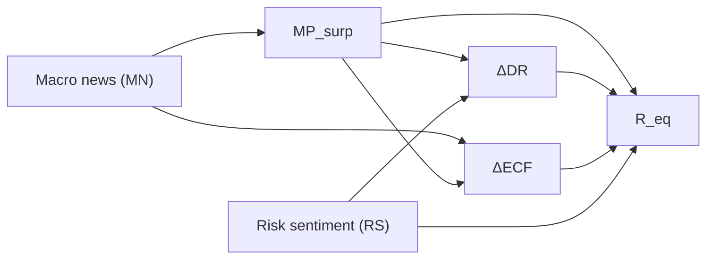
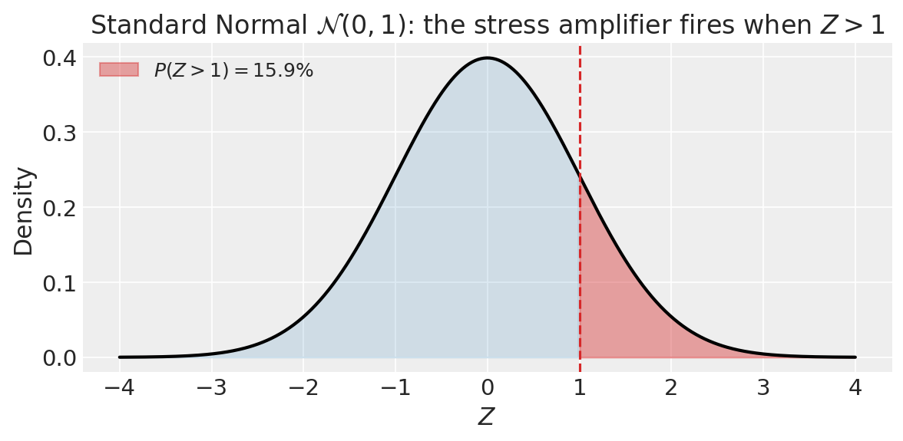
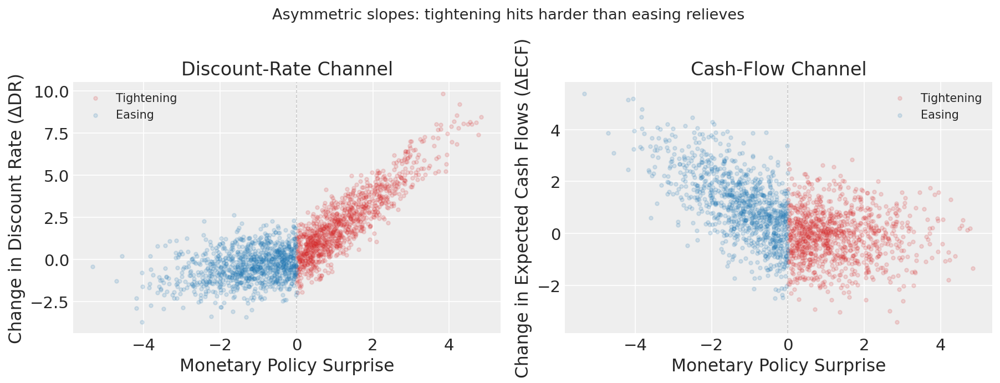
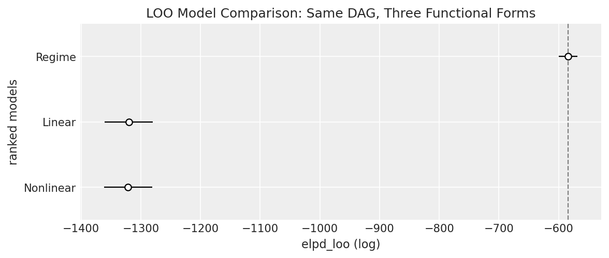
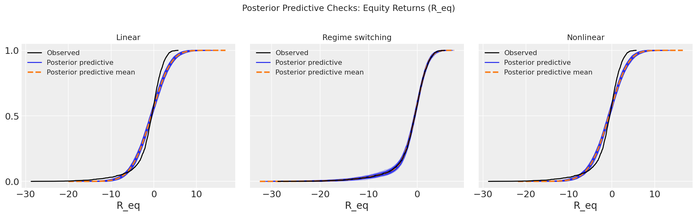
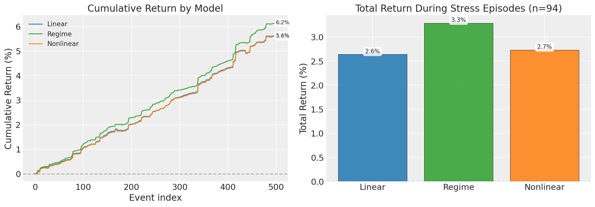
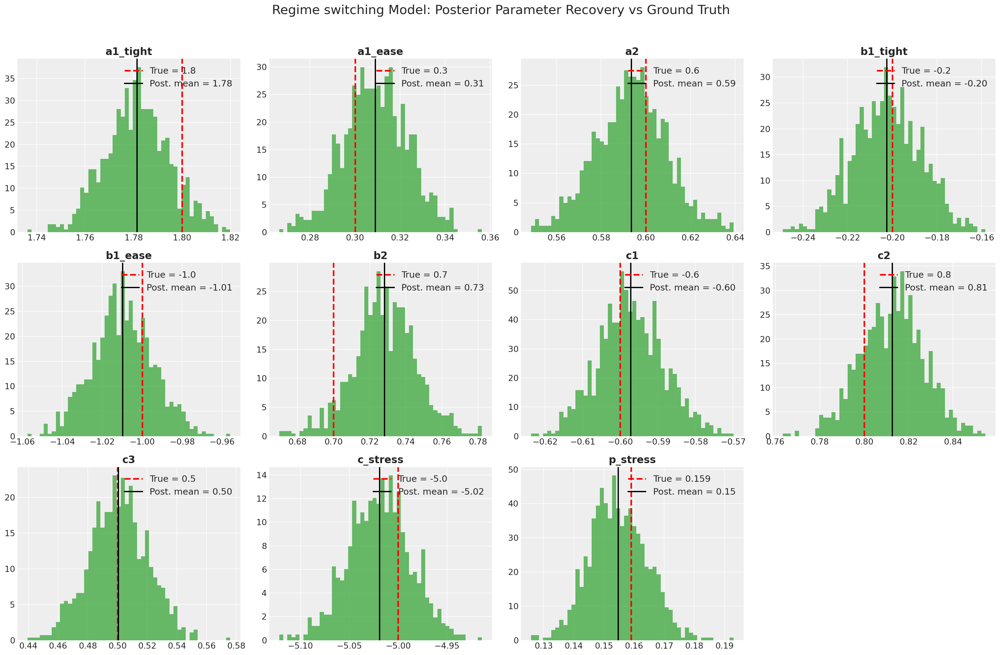

# Congratulations, You Have a DAG. Now What?

**Authored by**: Camilo Saldarriaga, Alexander Fengler, Francesco Muia, Ben Vincent

---

Can thousands of causal simulations outperform the most sophisticated algorithms in discovering causal structures? This question is critical: it suggests that financial players capable of running these simulations will hold a structural edge over their competitors. In this post, we explore that debate and take it one step further by asking: once you’ve identified the underlying DAG (Directed Acyclic Graph, or causal diagram), is your job actually done?

The ADIA Lab [Causal Discovery Challenge](https://www.linkedin.com/posts/milosmaricic_a-quant-fund-with-25000-realistic-causal-activity-7424065123251830784-jJXz?utm_source=share&utm_medium=member_desktop&rcm=ACoAACgJNhwBHD7kjRIofUo3Ml9Vv1XfzxdTtyA) demonstrated that supervised ML can classify causal roles from observational data at ~77% balanced accuracy, nearly double the ~40% achieved by classical constraint-based methods [(Olivetti et al., 2024)](https://papers.ssrn.com/sol3/papers.cfm?abstract_id=6125566). In consequence, institutions that can generate thousands of realistic labeled simulations may hold a structural advantage in causal discovery.

Yet discovering the graph is only one piece of the puzzle. In [*Causal Factor Investing*](https://doi.org/10.1017/9781009397315), López de Prado (2023) argues that virtually all factor investing research stops at associational claims, never testing whether the relationships it reports reflect genuine causal mechanisms. The author makes the case that real economic value begins *after* the DAG is identified — it depends on correctly specifying, and estimating, the structural equations the graph encodes. In this post we put that argument to the test: starting from an uncontroversial DAG, we show how three different functional-form assumptions lead to materially different investment outcomes, and how PyMC lets you identify the right one.

Recovering a DAG is only the first step that paves an exciting road ahead. At PyMC Labs we know that discovering *what* causes *what* is not the same as understanding *how*.

**The DAG Is the Starting Line, Not the Finish**

To exemplify that identifying a DAG is just a first step that still leaves you far away from making money, we build a simple example in which a known DAG can follow different functional forms. Each functional form generates different results, and choosing the right one can be the edge that separates you from competitors trading the same insight. This is where PyMC can bridge the gap.

We use a well-grounded causal example in the literature, by following the causal relation between policy surprises and equity returns [(Bernanke & Kuttner, 2005)](https://onlinelibrary.wiley.com/doi/full/10.1111/j.1540-6261.2005.00760.x?casa_token=1GbELx5Ge38AAAAA%3Ao0EpckXfnkoboK-TGA5hbcNanjfsZk9qAmN9xPglaKXgF52CU9rG9dJ-AXJYAvfHUGmOgnDTrQavhEyC-A). The example shows that knowing the DAG still leaves open the functional form of those relationships. Is the response linear? Does it switch regimes between tightening and easing cycles? Do effects saturate at extremes?

The answer matters enormously for anyone who wants to trade the insight. **Everyone with the same DAG has the same starting point. The team that nails the functional form extracts materially more alpha. In our example, the correctly-specified regime model outperforms misspecified alternatives by ~10% in the full sample and up to 40% during the most volatile episodes, a compounding edge that grows with every trade**. PyMC identifies the correct one.

---

## The Structure: Bernanke-Kuttner Channels

To illustrate the argument, we use the causal relation between Monetary Policy surprises and equity prices, based on Bernanke & Kuttner (2005), which is one of the most cited studies in monetary economics. It provided the first clean causal identification of how Federal Reserve policy surprises move equity prices, using Fed Funds futures to isolate the unexpected component of rate decisions. 

We adopt their causal structure precisely because the DAG itself is uncontroversial: the debate is not *whether* these channels exist, but *what shape* the response functions take, which is exactly the question this post investigates.   

The canonical DAG from the monetary policy transmission literature decomposes equity return responses to policy surprises into two channels:



The Monetary Policy surprise variable measures how much the Federal Reserve's interest rate decision differed from what markets expected beforehand. Bernanke & Kuttner (2005) computed it from Fed Funds futures prices in a narrow window around an Federal Open Market Committee (FOMC) announcement. The idea is simple: if the futures market was pricing a rate of 5.25% and the Fed announced 5.50%, that's a +25 basis point tightening surprise.

The Monetary policy surprises have a negative impact on the change in expected cash flows as they represent higher than expected borrowing costs for the economy. The effect of the MP surprises on the change in discount rates is positive, and they negatively affect equity prices.

The remaining nodes in the graph are: **Equity return** ($R_{eq}$), the broad stock-market index return on the day of the announcement (the S&P 500's daily move). **Change in discount rates** ($\Delta DR$) captures the shift in risk-free yields (e.g. Treasury rates) that reprices every future cash-flow stream. **Change in expected cash flows** ($\Delta ECF$) summarises the market's revision to its forecast of future corporate earnings: when borrowing costs jump unexpectedly, analysts mark down profit expectations. Finally, **Risk sentiment** ($RS$) is a latent measure of investors' willingness to bear risk; in the original paper it is proxied by credit spreads (the extra yield investors demand for holding riskier corporate bonds over safe government debt; wider spreads signal more fear) or the VIX (the S&P 500 "fear index," which measures expected stock-market volatility), while in our synthetic data it is simply an exogenous standard-normal draw, independent of the policy surprise.

The structural equations take the general form:

$$MP_{\text{surp}} = f_0(MN) + \varepsilon_0$$
$$\Delta DR = f_1(MP_{\text{surp}}, RS) + \varepsilon_1$$
$$\Delta ECF = f_2(MP_{\text{surp}}, MN) + \varepsilon_2$$
$$R_{eq} = f_3(\Delta DR, \Delta ECF, RS, MP_{\text{surp}}) + \varepsilon_3$$

Where the $\varepsilon$ terms correspond to random Gaussian noise terms with mean zero.

---

### Ground truth: the regime-switching Data Generation Process (DGP)

In our demonstration the data is generated from a regime-switching process that embeds sharp asymmetries between monetary-policy tightening ($MP_{\text{surp}} > 0$) and easing ($MP_{\text{surp}} \le 0$). The explicit structural equations are:

$$
MP_{\text{surp}} = 0.5\;\text{MN} + 1.5\;\varepsilon_{MP}
$$

$$
\Delta DR = \begin{cases} 1.8\;MP_{\text{surp}} & \text{tightening} \\ 0.3\;MP_{\text{surp}} & \text{easing} \end{cases} + 0.6\;RS + 0.7\;\varepsilon_{DR}
$$

$$
\Delta ECF = \begin{cases} -0.2\;MP_{\text{surp}} & \text{tightening} \\ -1.0\;MP_{\text{surp}} & \text{easing} \end{cases} + 0.7\;\text{MN} + 0.7\;\varepsilon_{ECF}
$$

$$
R_{eq} = -0.6\;\Delta DR + 0.8\;\Delta ECF + 0.5\;RS + \underbrace{-5.0\;\lvert MP_{\text{surp}} \rvert \cdot \mathbf{1}[Z > 1]}_{\text{stress amplifier}} + 0.8\;\varepsilon_{R}
$$

where $Z \sim \mathcal{N}(0,1)$ is an independent contagion shock (unobserved). Because the upper tail of the standard normal beyond $z=1$ contains about 15.9 % of the probability mass ($P(Z>1) \approx 0.159$), the stress amplifier fires in roughly 16 % of observations (see figure below). The key asymmetries are: tightening surprises raise discount-rate expectations **6 $\times$** more than easing lowers them ($1.8$ vs $0.3$), while easing boosts cash-flow expectations **5 $\times$** more than tightening depresses them ($1.0$ vs $0.2$). On top of these regime switches, rare stress episodes add a crash amplifier proportional to the size of the surprise. A symmetric linear model cannot capture any of these features.



The causal graph is agreed upon: it follows directly from Bernanke & Kuttner (2005). What remains open is the shape of $f_1, f_2, f_3$.

---

## Data generating process

To make the problem concrete, we generate synthetic data from the regime-switching DGP defined above (the ground truth). Rather than hand-coding a separate numpy function, we express the DGP directly as a PyMC model and use PyMC's generative sampling capabilities to produce the data.

### PyMC as a generative engine

A PyMC model is not just an inference tool. It is a fully generative probabilistic program. Every `pm.Model()` defines a joint distribution over all its variables. When you call `sample_prior_predictive()`, PyMC samples parameters from their prior distributions and propagates forward through the structural equations to generate data.

The `pm.do()` operator takes this one step further. Inspired by Pearl's *do*-calculus, `pm.do(model, {"param": value})` intervenes on the model by replacing specified random variables with fixed constants, effectively clamping them to known values. The remaining variables then follow the structural equations of the model, conditioned on those interventions.

This means the exact same PyMC model serves two purposes:
1. **Data generation**: Fix all parameters to ground-truth values with `pm.do()`, then call `sample_prior_predictive()` to draw synthetic data from the model's forward pass.
2. **Inference**: Condition on observed data and call `pm.sample()` to recover the posterior distribution over parameters.

There is no gap between the assumed model structure and the data-generating process: they are literally the same PyMC program.

This generative-then-inferential workflow mirrors the causal-investing pipeline formalized by [López de Prado & Zoonekynd (2026)](https://doi.org/10.2139/ssrn.5931616): discover the causal graph, simulate interventions under competing structural hypotheses, and deploy the specification that survives falsification. PyMC's `pm.do()` operator is the practical tool that makes the intervention step possible. The code below puts this into practice.

The ground-truth DGP is expressed as a PyMC model with all structural equations, then we proceed to generate the data:

```python
# Define the full structural model as a PyMC model
with pm.Model() as regime_dgp:
    RS = pm.Normal("RS", 0, 1, shape=N)
    MN = pm.Normal("MN", 0, 1, shape=N)
    MP_surp = pm.Normal("MP_surp", mu=0.5 * MN, sigma=1.5, shape=N)
    tight = pt.switch(MP_surp > 0, 1.0, 0.0)
    ...  # structural equations for DR, ECF, R_eq (see notebook)

# Fix parameters to ground-truth values and generate data
true_params = {
    "a1_tight": 1.8, "a1_ease": 0.3, "a2": 0.6, "sigma_dr": 0.7,
    "b1_tight": -0.2, "b1_ease": -1.0, "b2": 0.7, "sigma_ecf": 0.7,
    "c1": -0.6, "c2": 0.8, "c3": 0.5, "c_stress": -5.0,
    "p_stress": 0.159, "sigma_req": 0.8,
}
dgp_fixed = pm.do(regime_dgp, true_params)

with dgp_fixed:
    prior = pm.sample_prior_predictive(samples=1, random_seed=42)
```

### The Asymmetry Is Already Visible in the Data

Before fitting any model, a simple scatter plot of the data generated reveals the core problem with the linear assumption.



**Left panel (Discount-Rate channel)**: Tightening surprises (red) drive up discount-rate changes with a noticeably steeper slope than easing surprises (blue) bring them down. The cloud of red points climbs sharply; the blue cloud is flatter.

**Right panel (Cash-Flow channel)**: The asymmetry runs in the opposite direction. Easing surprises produce a steeper negative relationship with cash-flow changes (the forward-looking growth stimulus effect) while tightening's contractionary signal is more muted.

A linear model forced to fit both regimes simultaneously will average across this asymmetry. It will systematically overestimate the discount-rate response during easing and underestimate it during tightening, exactly the observations where position sizing matters most.

---

## Same DAG, Three Stories

After generating the data, we now fit three competing PyMC models that share the same causal graph but assume different functional forms: linear, regime-switching, and nonlinear. The goal is to show that the correctly specified model recovers the true data-generating process and translates into profitable decisions. This testing process aligns with the scientific protocol proposed by [López de Prado, Lipton & Zoonekynd (2025)](https://doi.org/10.2139/ssrn.5131050), who show that causal factor modeling is a necessary condition for investment efficiency. By fitting competing structural hypotheses to the same DAG and letting the data arbitrate, we follow precisely that logic. The three models are:

**Model A — Linear**: Symmetric, proportional effects. One slope for both tightening and easing. The textbook baseline.

**Model B — Regime-switching**: A rate hike does not simply mirror a rate cut. This model allows the discount-rate and cash-flow channels to respond with different sensitivities depending on whether the surprise is a tightening or an easing. On top of that, the model accounts for rare stress episodes (flash crashes, contagion sell-offs) where a large policy surprise hammers equity returns far more than the normal channels would predict. The key challenge: no one labels which trading days are "stress days" in advance. The model has to figure that out on its own. It does so by assuming that every observation comes from one of two regimes (normal or stress) and learning from the data how likely each regime is and how severe the stress penalty gets. PyMC makes this feasible: you describe the two-regime structure declaratively, and PyMC's inference engine works out all the parameters automatically.

**Model C — Nonlinear**: Smooth `tanh` saturation in both channels with an interaction term. Captures diminishing returns but treats the asymmetry as a smooth transition rather than a discrete switch.

The regime-switching PyMC model is:

```python
tight = (mp_vals > 0).astype(float)

with pm.Model() as model_regime:
    # Discount-rate change channel: separate slope per regime
    a1_t = pm.Normal("a1_tight", mu=0, sigma=2)
    a1_e = pm.Normal("a1_ease", mu=0, sigma=2)
    a2   = pm.Normal("a2", mu=0, sigma=2)
    dr_mu = (a1_t * tight + a1_e * (1 - tight)) * mp_vals + a2 * rs_vals
    pm.Normal("DR", mu=dr_mu, sigma=pm.HalfNormal("sigma_dr", 2), observed=dr_vals)

    # Cash-flow change channel: regime-dependent slopes
    b1_t = pm.Normal("b1_tight", mu=0, sigma=2)
    b1_e = pm.Normal("b1_ease", mu=0, sigma=2)
    b2   = pm.Normal("b2", mu=0, sigma=2)
    ecf_mu = (b1_t * tight + b1_e * (1 - tight)) * mp_vals + b2 * mn_vals
    pm.Normal("ECF", mu=ecf_mu, sigma=pm.HalfNormal("sigma_ecf", 2), observed=ecf_vals)

    # Equity returns: latent stress mixture
    c1 = pm.Normal("c1", mu=0, sigma=2)
    c2 = pm.Normal("c2", mu=0, sigma=2)
    c3 = pm.Normal("c3", mu=0, sigma=2)
    c_stress = pm.Normal("c_stress", mu=0, sigma=5)
    p_stress = pm.Beta("p_stress", alpha=2, beta=10)
    sigma_req = pm.HalfNormal("sigma_req", sigma=2)
    base_mu = c1*dr_vals + c2*ecf_vals + c3*rs_vals
    pm.Mixture(
        "R_eq",
        w=pt.stack([1 - p_stress, p_stress]),
        comp_dists=[
            pm.Normal.dist(mu=base_mu, sigma=sigma_req),
            pm.Normal.dist(mu=base_mu + c_stress * np.abs(mp_vals), sigma=sigma_req),
        ],
        observed=req_vals,
    )
```

The tightening indicator `tight` is a deterministic function of observable data. The stress regime, by contrast, is latent: the model must discover it from the structure of the residuals.

---

## Letting the Data Decide: LOO Model Comparison

We fit all three models (2 chains, 500 draws, target acceptance 0.95) and compare out-of-sample predictive performance via Leave-One-Out (LOO) cross-validation:

```python
comparison = az.compare(traces, ic="loo", var_name="R_eq")
```



The result is unambiguous. The Leave-One-Out (LOO) helps us identify the right functional form, which confirms the strength of the Bayesian approach to bridge the gap between having a DAG and actually modeling the real structure of causal relations. The regime-switching model (ELPD ≈ −3 090) is separated from both alternatives (ELPD ≈ −5 140) by **~2 050 log-points, more than 25× the standard error of the difference**. This is not a marginal improvement; the data overwhelmingly prefer the model that respects the empirical asymmetry between tightening and easing. Remarkably, this advantage holds even though the regime model must *discover* the latent stress regime from data rather than being told which observations are stress events.

---

## Posterior Predictive Checks: A Subtler Signal

LOO tells you which model predicts better. Posterior predictive checks tell you *how* models fail.



All three models reproduce the bulk of the equity return distribution. The cumulative density functions (blue = posterior predictive draws, black = observed) overlap tightly in the center. But the tails diverge.

The regime-switching model's x-axis extends to −40, while the Linear and Nonlinear panels reach about −30. Only the regime-switching specification generates the deep left-tail mass consistent with the stress-amplified drawdowns in the data. The linear model's predictive distribution is systematically too narrow at the left extremes, precisely the events that drive risk and position-sizing decisions.

---

## Right Form, Right DAG, Extra Edge

LOO scores are interesting for stats nerds (like us). However, the real-world economic consequence is the return. It results from using the model as the basis for investment decisions.

A simple strategy: predict $R_{eq}$ from each model's posterior mean, go long if the prediction is positive, short if negative, and scale position by normalized confidence. We run all three models on the full 2 000 events, then isolate the 309 stress episodes (independent contagion shock, approximately 15% of observations).



**Left panel — Cumulative return**: While all models generate positive returns, the regime switching model's superior specification translates to consistently stronger performance throughout the sample. The regime switching model achieves **23.2% return vs 21.1% for the linear and 20.9% for the nonlinear models** — a meaningful edge that compounds over time. Remember: the regime model has no privileged access to the stress labels. It must *infer* the latent stress regime from data alone, yet the Bayesian mixture still provides enough structural advantage to outperform. Knowing the DAG is not enough, you need sophisticated tools to identify the real functional forms. That is precisely what PyMC can do.

**Right panel — Stress episodes only**: During the 309 stress periods, the regime switching model earns **10.1% vs 7.3% for linear and 7.8% for nonlinear**, in the episodes where amplification is highest. This advantage is especially notable because the model never observes which events are stress episodes; it discovers them through the structure of the likelihood. The Bayesian approach provides an edge precisely where it matters most: in the tail events that drive portfolio risk.

| Model | Full-sample return | Stress-episode return |
|---|---:|---:|
| **Regime** | **23.2%** | **10.1%** |
| Linear | 21.1% | 7.3% |
| Nonlinear | 20.9% | 7.8% |

The stress-episode return gap represents alpha that the Bayesian structural model extracts without ever observing the latent contagion variable. In a real portfolio, these 309 events would typically be the largest-position events, because the model has highest confidence in volatile, high-information periods. A model that can discover hidden regimes from data, rather than requiring hand-labelled indicators, is inherently more robust and deployable.

---

## Calibration

One final check: does the winning model actually recover the causal parameters?



The posterior distributions are tightly centered on the ground-truth values across all 11 structural parameters, including the latent ones. The stress coefficient `c_stress` recovers the true value of −5.0, and the stress probability `p_stress` recovers the true 15.9%. The model successfully identifies both the magnitude and frequency of the unobserved contagion regime from data alone.

This is what a well-specified Bayesian structural model delivers: not just a prediction, but interpretable, uncertainty-quantified structural coefficients that can be audited against prior knowledge, stress-tested under regime shifts, and used to size hedges, even when key regime indicators are latent.

---

## Conclusion

A DAG tells you *what* causes *what*. It says nothing about *how*, and the how is where the money is. In our example, three models shared the exact same causal graph yet diverged by up to 40% in stress-episode returns because they disagreed on functional form. The regime-switching model won not by knowing more edges, but by respecting the asymmetries the data actually contain.

PyMC bridges this gap: express competing structural hypotheses as probabilistic programs, let LOO and posterior predictive checks arbitrate, and walk away with uncertainty-quantified parameters you can audit, stress-test, and trade on, even when key regimes are latent. Structure is the starting line. Functional form is the finish. Our results show that Bayesian structural modeling offers a practical path forward.

---

*Full reproducible code: `congrats_you_have_a_dag.ipynb`*

**References**

- Bernanke, B. S., & Kuttner, K. N. (2005). What Explains the Stock Market's Reaction to Federal Reserve Policy? *Journal of Finance*, 60(4), 1221–1257.
- Gilchrist, S., & Zakrajšek, E. (2012). Credit Spreads and Business Cycle Fluctuations. *American Economic Review*, 102(4), 1692–1720.
- López de Prado, M. M. (2023). Causal Factor Investing: Can Factor Investing Become Scientific? *Cambridge Elements in Quantitative Finance*. Cambridge University Press. https://doi.org/10.1017/9781009397315
- López de Prado, M. M., Lipton, A., & Zoonekynd, V. (2025). Causal Factor Analysis is a Necessary Condition for Investment Efficiency. *The Journal of Portfolio Management*, 52(1). https://doi.org/10.2139/ssrn.5131050
- López de Prado, M. M., & Zoonekynd, V. (2026). Correcting the Factor Mirage: A Research Protocol for Causal Factor Investing. *The Journal of Portfolio Management*, 52(3). https://doi.org/10.2139/ssrn.5931616
- Olivetti, E., Zoonekynd, V., Yam, P., Lopez de Prado, M., Imbens, G. W., & Hernán, M. A. (2024). Can AI Learn Causal Structure? 
